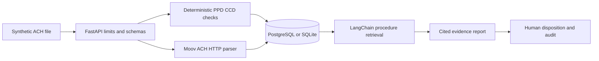

# ACH Payment Exception Intelligence

[](https://github.com/sairohiththummarakoti/ach-payment-exception-intelligence/actions/workflows/ci.yml)

A runnable synthetic ACH analyst workflow: upload a fixed-width file, validate its records and controls, compare probable duplicates, retrieve cited procedure sections, and record a human disposition with an audit trail. It cannot submit or move money.

The default no-key demo uses SQLite and a deliberately limited PPD/CCD parser. Docker Compose adds PostgreSQL and the official **Moov ACH HTTP service v1.68.0**. The API exposes its active parser mode; a configured but unavailable Moov service fails closed.

## Start with Docker

```sh
docker compose up --build -d --wait
docker compose exec api ach-demo smoke --url http://localhost:8001
```

Open [interactive API documentation](http://localhost:8001/docs). API, database and parser ports bind only to loopback. The local database password in Compose is a synthetic development credential. `docker compose down` stops services and retains evidence in the named PostgreSQL volume.

## Start locally

Install Python 3.12 and [uv](https://docs.astral.sh/uv/getting-started/installation/), then run:

```sh
uv sync --frozen
uv run ach-demo generate
uv run ach-demo demo
uv run uvicorn ach_intelligence.api:app --host 127.0.0.1 --port 8001 --no-access-log
```

The first two demo commands produce 37 labeled fixtures and run upload-equivalent validation, cited analysis and an audited analyst comment. No model download or API credential is required. Startup runs the versioned Alembic migration. Set `ACH_DATABASE_URL` to use PostgreSQL, and `ACH_MOOV_URL` to enable real Moov validation. Configuration examples are in `.env.example`.

## Upload and review

```sh
curl -H 'X-Synthetic-Data: true' -F 'file=@data/fixtures/bad_batch_credit.ach;type=text/plain' http://localhost:8001/api/v1/ach/files
curl -X POST http://localhost:8001/api/v1/ach/exceptions/EXCEPTION_ID/explain
curl -X POST -H 'Content-Type: application/json' -d '{"action":"escalate","reviewer":"demo-analyst","comment":"Compare control with source records","expected_version":0}' http://localhost:8001/api/v1/ach/exceptions/EXCEPTION_ID/review
```

Use the returned exception UUID in the next calls. On Windows PowerShell, use `curl.exe` or the Python `ach-demo smoke` command. A valid baseline contains 2 entries, **12,345 credit cents** and **7,600 debit cents**. The bad credit fixture returns `BATCH_CREDIT_TOTAL` with expected `12345` and observed `1`. Reviewing an exception never changes the underlying validation result.

## Implemented behavior

- Record lengths/order, headers, PPD/CCD profile, routing checksums, required fields, dates, trace identifiers, entry hashes, counts and debit/credit control totals.
- File-fingerprint idempotency, duplicate trace/account-amount-date findings, and bounded cross-file evidence lookup. Decisions and explanations persist with timestamps and source IDs.
- LangChain procedure retrieval over locally authored, versioned notes; cited explanations and R01/R02/R03/R04/R29 definitions. Unknown codes remain unknown.
- Approve, reject, escalate and comment with optimistic version checks. Closed dispositions accept comments only. An optional bearer token protects routes beyond the health endpoint.
- Configurable Ollama support with one bounded call: the model may reorder a complete set of validated factual claims. Arbitrary model prose, tools and citations are rejected; failures use the offline evidence report.

## Verify and evaluate

```sh
uv run ruff check .
uv run ruff format --check .
uv run mypy
uv run pytest -q -m 'not integration'
uv run ach-demo evaluate --output artifacts/evaluation.json
```

If Windows denies access to pytest's default temporary directory, append `--basetemp artifacts/pytest-run` using a new disposable directory. Real-adapter tests require `TEST_MOOV_URL=http://localhost:8081`; optionally set `TEST_DATABASE_URL` to a dedicated PostgreSQL test database. CI starts the complete stack, runs these tests, and exercises the actual HTTP API.

Measured on `synthetic-ach-v1`: **37/37** labeled validation scenarios, **6/6** return lookups, **58/58** reports with valid citations and relevant retrieval, and **143/143** supported fixed-template claims. These are small authored-fixture results, not an estimate of production accuracy. The exact report and denominator definitions are in [evaluation documentation](docs/EVALUATION.md).

## Architecture and limits



This educational profile excludes addenda, prenotes, IAT and other SEC codes. It does not implement an entire Nacha rules engine, real account verification, return ingestion, regulatory compliance, identity authentication, TLS termination or payment execution. Offline and external parser results are identified separately. Only synthetic inputs are permitted; the upload attestation is a user assertion, not a PII detector. Read [security boundaries](docs/SECURITY.md) before changing network exposure.

More: [requirements](docs/REQUIREMENTS.md), [architecture](docs/ARCHITECTURE.md), [API](docs/API.md), [demo](docs/DEMO.md), [evaluation](docs/EVALUATION.md). Apache-2.0 license.
