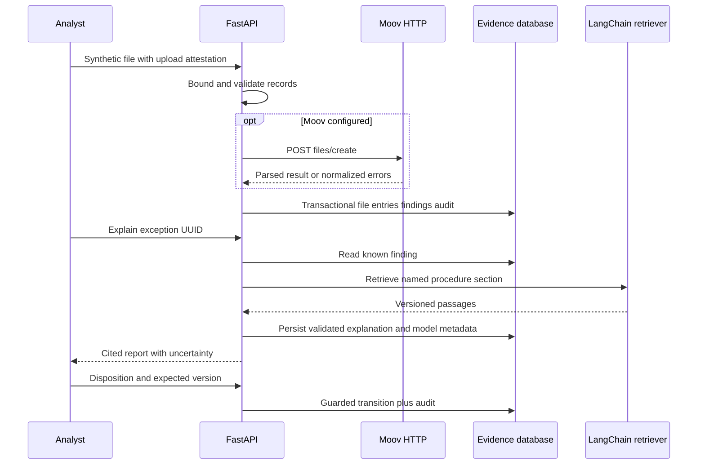

# Architecture

`api.py` bounds requests, validates UUIDs/input schemas, optionally checks a bearer token and dispatches blocking work off the event loop. `parser.py` consumes printable ASCII records in sequence and recalculates controls with integer cents. It retains hashes and masks instead of account/name text. `adapters.py` calls only Moov's `/files/create` parser endpoint, with ten-second timeout, no redirects and no automatic POST retries. Normalized parser errors retain useful validation text after account/name/number redaction.

`service.py` performs transactional persistence and duplicate comparison. SQLAlchemy stores files, batches, entries, exceptions and append-only application audit records. SQLite uses `BEGIN IMMEDIATE`; PostgreSQL uses a transaction-scoped advisory lock to serialize the small demonstration write workload across processes. Fingerprint uniqueness prevents repeated business effects. Review uses a required expected version to reject stale submissions.

The local procedure retriever is a real LangChain `BaseRetriever` implementation using deterministic lexical ranking and section routing. It is intentionally a small, auditable reference corpus. Optional Ollama can only permute prevalidated claims, preserving every fact and citation. It has no tool-selection channel or access to input files. The offline path has no network dependency.

Schema migration `0001` lives inside the installed package. Startup upgrades the configured database; a dedicated production migration process would be preferable for a larger deployment. Current writes are serialized for correctness, not high throughput. No authentication is required by default because the supplied service binds to loopback and uses only synthetic evidence. An optional bearer token is not an enterprise identity system.

Version verification used the [Moov ACH v1.68.0 source](https://github.com/moov-io/ach/tree/v1.68.0) and [official file-create HTTP documentation](https://moov-io.github.io/ach/create-file/). The HTTP service is a Go program in its own container, never represented as a native Python library.
